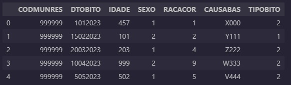
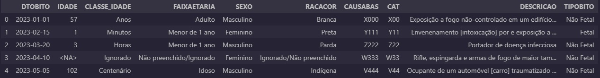
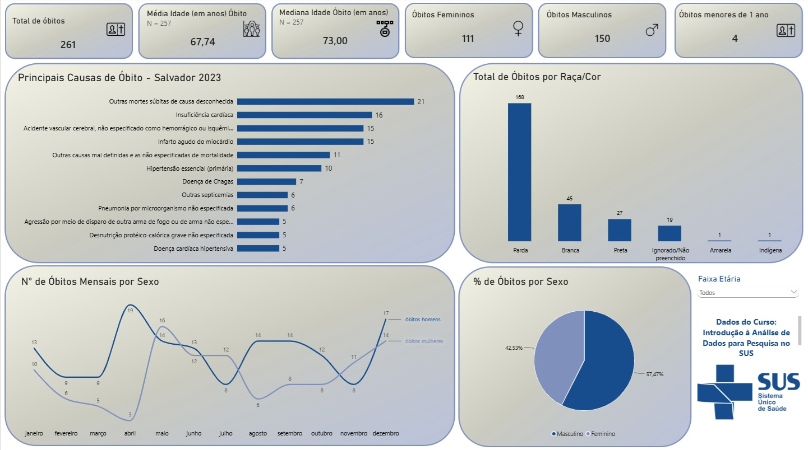
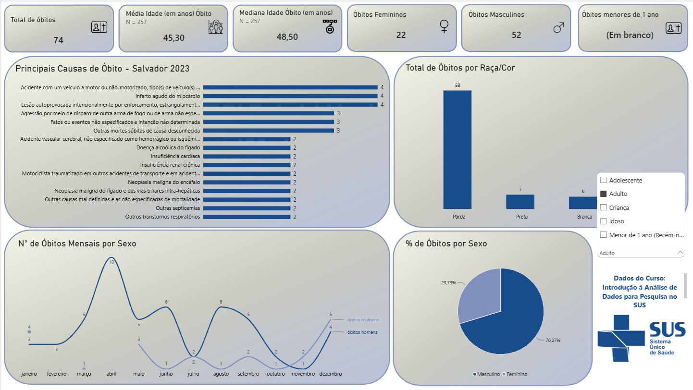
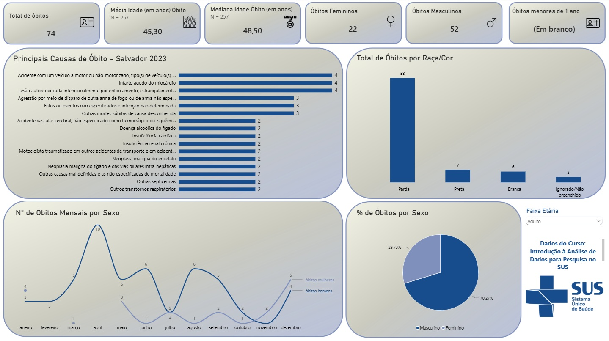

# Análise de Óbitos - SIM Salvador 2023

## 📌 Sobre o Projeto
Este projeto é parte do meu portfólio de transição da bancada de laboratório para a Análise de Dados em Saúde. O objetivo foi tratar, analisar e visualizar os dados de óbitos do município de Salvador no ano de 2023, utilizando a base pública do Sistema de Informação sobre Mortalidade (SIM), disponibilizada no curso "Introdução à Análise de Dados para Pesquisa no SUS" da Fiocruz.

## 🛠️ Ferramentas Utilizadas
* **Python** (Pandas, NumPy) para limpeza, tratamento e enriquecimento dos dados.
* **Power BI** para a construção do painel analítico e visualização interativa.
* **Jupyter Notebook** para documentação do código.

## ⚙️ Etapas de Tratamento (O que eu fiz no Python)
- **Remoção de dados sensíveis:** Após importar o banco de dados do SIM e a tabela simplificada do CID-10, comecei removendo o código de residência dos indivíduos, respeitando a LGPD e removendo uma coluna que não acrescentaria para a análise atual.
- **Tratamento de datas:** Ajustei a coluna `DTOBITO`, que inicialmente era da classe inteiros, para string, garantindo que todas as datas apresentassem 8 dígitos com `zfill` e, em seguida, transformei para o padrão datetime.
- **Tradução de categorias:** Traduzi as categorias `SEXO`, `RACACOR` e `TIPOBITO` de códigos para seus significados por escrito (exemplo: na coluna SEXO, os códigos 1 e 2 foram substituídos por "Masculino" e "Feminino", respectivamente), por meio de `map` ou funções.
- **Criação de faixas etárias:** Gerei uma nova coluna para classificar os indivíduos de acordo com sua faixa etária, seguindo uma classificação simplificada do SUS.
- **Enriquecimento com CID-10:** Adaptei a coluna de causa base do óbito `CAUSABAS`, onde estavam apenas os códigos do CID-10, de 4 para 3 dígitos (sem perder o significado principal do código) e, em seguida, a enriqueci mesclando a tabela CID-10 para que o dataframe apresentasse o código e a descrição por extenso da causa de óbito.
- **Criação de amostra fictícia:** Após preparar o banco de dados e exportá-lo para o Power BI, criei um banco pequeno fictício (`amostra_ficticia_fc.csv`) com o auxílio de IA para testar novamente o código e disponibilizá-lo no portfólio sem expor os dados reais.

## 📊 Principais Insights (Resultados)
* O total de óbitos registrados foi de 261 casos.
* A média de idade entre os óbitos com idade em anos foi de 67,74 anos, com mediana de 73 anos (indicando uma concentração de óbitos na população idosa).
* A maioria dos óbitos ocorreu na população masculina (57,47%) e em pessoas pardas (168 casos).
* A principal causa de óbito isolada foi "Outras mortes súbitas de causa desconhecida" (21 casos), o que indica uma necessidade de averiguar a dificuldade de identificar a causa do óbito em aproximadamente 8% dos casos.

## ⚖️ Privacidade e LGPD
**Observação:** Para o portfólio público, os dados foram analisados de forma agregada. O banco de dados original não está disponível neste repositório (apenas uma amostra fictícia com dados inventados para fins didáticos). Os dados reais foram utilizados apenas para a geração do painel no Power BI e, como mencionado anteriormente, foram obtidos por meio do curso "Introdução à Análise de Dados para Pesquisa no SUS" da Fiocruz.

## 🖼️ Demonstração do Tratamento (Dados Fictícios)
Abaixo, a prova de que o código funciona utilizando a amostra fictícia criada para testar as regras de negócio sem expor dados reais.

## 📊 Painel no Power BI

---
*Dados provenientes do curso "Introdução à Análise de Dados para Pesquisa no SUS" (Fiocruz).*